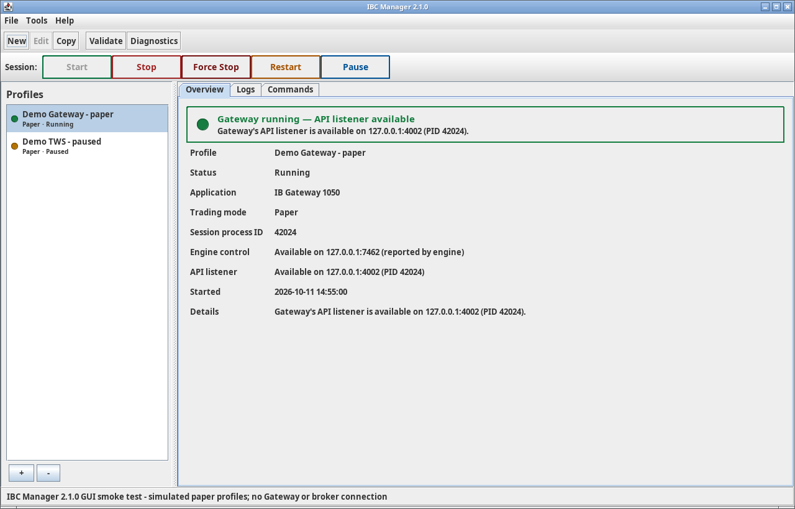

# IBC Manager

**Version 2.3.0 | Windows x64 | TWS and IB Gateway**

Version 2.3.0 recovers from the explicit expired-token dialog during an already
logged-in Gateway session as well as during a warm-restart login. Normal warm
restarts remain supported. The RDP headless workaround pins both **JBR
25.0.4-b508.27** and **JavaFX 25.0.4**; profile format remains 7. See
[restart modes](docs/RESTART_MODES.md), [the October 25 fix](docs/ESTABLISHED_SESSION_EXPIRY_FIX.md)
and [executed validation and remaining checks](TEST_REPORT.md).



*Actual application captured by the GUI smoke test with simulated paper profiles;
no live account or broker connection is shown.*

IBC Manager configures, starts and supervises Interactive Brokers **Trader Workstation
(TWS)** and **IB Gateway** using a maintained IBC engine included in the application.
Install the official offline TWS/Gateway application separately. FIX is not supported.
Manager does not place trades.

## New in 2.3.0: expiry recovery after a completed Gateway login

The October 25 incident occurred during reconnect in an already logged-in Gateway.
Version 2.3.0 recognizes the exact expiry message under both known dialog titles,
`Gateway` and `IBKR Gateway`. It retains the earlier logged-out warm-start case and
adds recovery for an established session. Manager displays the reason and clears
old readiness while fresh authentication begins.

Established-session recovery dismisses the verified expiry modal and requests a
graceful close on a worker thread. A 30-second deadline bounds shutdown; its fallback
is limited to that engine JVM. A dedicated marker makes the replacement a cold start
without changing normal daily warm restarts. Credentials and any requested IB Key
approval remain necessary.

The handler does not trigger from an ordinary network disconnect, a calendar deadline,
active login/2FA, unrelated dialogs or `invalid twsInfo`. Owner/generation checks and
Stop/Pause arbitration guard stale and competing recovery actions before recovery
commits. After commitment, a later Stop reports the existing stop-in-progress
state; explicit Force Stop remains separate. A canceled or unpreparable claimed
recovery does not rearm within the same engine JVM and requires manual intervention.

A same-wrapper pending-authentication guard prevents a failed replacement from
falling back to stale warm-restart data. Successful replacement login clears the
guard; existing 2FA-timeout and login-display-timeout retry policies remain separate
and use fresh authentication. See
[restart modes](docs/RESTART_MODES.md) and [the incident fix](docs/ESTABLISHED_SESSION_EXPIRY_FIX.md).

## Retained from 2.1.0: the Gateway 1050 headless-start workaround

Gateway 10.50's bundled Java 25 can fail to create its window after a daily restart
in a disconnected Windows RDP session. This release automates the **JetBrains Runtime
25.0.4-b508.27 + separate JavaFX 25.0.4** setup that restored a successful warm restart in the reported
locked, disconnected-RDP test. It is a workaround for that configuration, not a universal
Java defect fix or an IBKR-certified runtime replacement.

**Edit Profile → IBC Java override → RDP headless workaround**

Select the checkbox, read the permission dialog, then **Save**. With all sessions using
that installation stopped, Manager downloads the pinned **Windows
x64, vanilla JBR 25.0.4-b508.27** and **all eight required OpenJFX 25.0.4 modules**, including `jdk.jsobject`, backs up the selected `.vmoptions`,
adds its marked options block, and assigns the managed Java override. Progress and
cooperative cancellation are shown. Merely checking the box or cancelling the editor
does not install anything.

To remove it, deselect, confirm and **Save**. The previous Java override and module
options are restored. Manager-owned runtime files and native cache are removed after
the last registered profile releases them. Your manual `C:\Java\JBR25`, JavaFX and other
pre-existing folders are **not deleted**. Edited/conflicting files are preserved and
reported instead of being blindly overwritten.

Downloads happen on explicit setup, **not on startup or every daily restart**. An existing
complete managed installation with both exact pins and matching local file hashes
is reused. No release catalogue or Maven metadata selects a newer version. A different
JBR build or JavaFX version requires explicit removal and reinstallation; unavailable
pinned downloads do not cause substitution.
See [setup, removal and recovery details](docs/MANAGED_RUNTIME.md).

### Verification during setup

The option reads **Fix Java 25 headless startup with managed JBR + JavaFX**.
Available publisher checksums are checked. If a checksum cannot be downloaded, or the
local Java/JavaFX test cannot run, times out or returns no usable result,
**setup continues with a warning**. An explicit JVM module-resolution failure is a
known incompatibility and stops setup; it is not an unavailable check. Skipped checks and any captured diagnostics are
recorded in `payload/download-provenance.txt`; an unavailable check is not marked passed.

Required files, safe extraction, HTTPS/TLS, available-checksum mismatches, ownership and
rollback safeguards remain. A successful module inventory reporting incompatible or
missing JavaFX modules still stops setup. A saved profile with a skipped probe is not
proof that Gateway can run: confirm a normal launch and disconnected-RDP restart.

The confirmation is short; all previous download and build-test fixes remain.

**Repairing an older incompatible managed installation only:** earlier packages selected a
different JBR build or omitted the required `jdk.jsobject` dependency. A working pinned
JBR 25.0.4-b508.27 / JavaFX 25.0.4 setup does not need removal or reinstallation for 2.3.0.
Stop all profiles using that installation, disable the workaround and **Save** on each,
then enable it and **Save** again. This installs JBR 25.0.4-b508.27 and the complete JavaFX 25.0.4 dependency set. Replacing
the Manager JAR alone does not replace an already-owned runtime. Do not edit its hashes
or copy individual files into it. Manual runtime folders and stored credentials are retained.
See [the dependency correction](docs/JAVAFX_DEPENDENCY_FIX.md) and
[verification details](docs/OPTIONAL_RUNTIME_CHECK.md).

## Other features

- **Microsoft OpenJDK 25 for Manager** and its Windows packaging tools. This is separate
  from the optional JetBrains runtime used by TWS/Gateway.
- **Copy profile** opens an independent editable copy with a new identity and unused
  ports. It starts disabled, with auto-start off and no copied stored password/session.
- Restored **TWS** discovery, launch, settings and guarded TWS-only Enable API command.
- One Profile editor for settings, credentials, authentication, recovery and Windows startup.
- Start, Stop, Restart, Pause and Force Stop confirmations; passive API-listener monitoring.
- Five-minute unanswered-2FA login retries, bounded failed-start recovery, protected saved
  passwords, live logs and redacted diagnostics. All 2.0.4 reliability fixes are retained.

## Install and run

**Windows package:** extract `IBC_Manager_2.3.0_Release_windows.zip` when available.
Use its installer or the portable `IBC Manager\IBC Manager.exe`. Keep the whole
portable folder, including `app` and `runtime`, together. The native build bundles
Microsoft Java 25; the ordinary Java Release ZIP does not bundle a JDK.

**Java release:** extract `IBC_Manager_2.3.0_Release.zip` and run `run.bat`. The script
selects Microsoft OpenJDK 25 or asks permission to download a verified copy into
`%LOCALAPPDATA%\IBCManager\tools\microsoft-jdk-25`. Existing Java installations remain
untouched. No system PATH or JAVA_HOME change is required.

## Profiles

Choose **New** or **Copy**, select **IB Gateway** or **Trader Workstation**, then detect
or select the offline installation, numeric version and settings directory. Choose
Paper/Live, credentials and the matching API port. Default API ports are 4001/4002 for
Gateway and 7496/7497 for TWS (Live/Paper). Custom ports remain editable.

For simultaneous sessions, use **separate settings directories and unique API/control
ports**. A copy duplicates configuration values, not the files in its settings directory;
review that directory before using copies together. Passwords, restart tokens, logs and
recovery history are not copied. A copied managed-runtime profile must opt in separately.

All settings are in **Edit Profile**. Generated `config.ini` files are diagnostics, not
a second configuration interface. Leave **IBC Java override** blank for the application's
bundled runtime, set it manually, or use the managed workaround. Do not change the
application/version/root while managed setup is enabled: disable and save first.

Start the profile and complete any IBKR authentication request yourself. TWS-only settings
are available again, but a legacy TWS profile previously disabled during migration is
not automatically enabled. Review it before use.

## Status and unattended use

**Green** reports an owned local API listener. It is not verification of your bot's
API handshake, account or trading permissions. **Yellow** covers startup, login/approval,
pause and recovery; **red** means stopped or action needed. Hover over the API row for
scope. No permanent handshake-warning paragraph is shown under Overview.

A login retry cannot approve 2FA or guarantee push delivery. Recovery does not change
Windows locking, transfer RDP sessions or install display drivers. Keep Manager running
for its watchdog, and test a scheduled restart with **RDP disconnected and Windows locked**
before relying on an installed runtime. The successful timestamp must precede reconnection.

## Invalid twsInfo and diagnostics

The managed runtime is pinned to **JBR 25.0.4-b508.27 + JavaFX 25.0.4**, matching
the working configuration supplied for the October 25 incident. Neither component
follows newer releases automatically.
This is a compatibility correction for the reported setup, not a bypass of IBKR's
server checks. A fresh login and a locked, disconnected-RDP restart still need
acceptance on the target machine.

An `invalid twsInfo` dialog now produces an explicit **ERROR** with its reason retained
after Gateway exits, even with exit code zero. Manager does not click OK, spoof
application identity, or repeatedly resubmit login to hide the rejection.

**Diagnostics** includes the existing Manager/live-runtime logs plus bounded,
redacted tails of accessible `launcher.log`, rotated launcher logs, plaintext
TWS/Gateway/API logs, JVM crash logs and recognizable exported logs under the
configured settings/installation directories. Runtime version/provenance, current
`.vmoptions`, the install4j `javaOptions` value and read-only native-launcher identity
hints are included when accessible. No native launcher is executed or modified.

`application-log-inventory.txt` maps collected files and reports missing, locked,
non-text, encrypted or size-limited sources. Encrypted `.ibgzenc` application logs
are listed but not decrypted or copied unredacted; export them through the application's
own log viewer when plaintext is needed. See [details and limits](docs/PINNED_RUNTIME_DIAGNOSTICS.md).

## Upgrade and data

Stop profiles, exit the old Manager and back up its **complete data directory** first.
Keep the same Windows account/computer and data directory to preserve DPAPI credentials.
For an existing working 2.1.0/2.2.0 setup using JBR 25.0.4-b508.27 and JavaFX
25.0.4, keep its Java override, files and managed-runtime selection unchanged. Extract 2.3.0 into a fresh application folder. The default
data directory is `%LOCALAPPDATA%\IBCManager`; a custom directory is supported:

```powershell
.\run.bat --data-dir "D:\IBCManagerData"
```

Saved profiles use **format 7** for managed-runtime ownership; formats 1–6 are readable.
Do not run versions that do not support format 7 against newly saved profiles. See the
[upgrade guide](docs/UPGRADE_GUIDE.md) before rollback, especially when managed runtime
changes are installed. The integrated engine uses `3.24.2-manager.8`; old active
engine caches are not overwritten.

## Build and test

On Windows, run **only** `package-windows.bat` to build the installer and portable ZIP.
It selects Microsoft JDK 25, asks permission for prerequisites, runs the build/test gates,
and produces `dist\IBC_Manager_2.3.0_Release_windows.zip`. WiX is required for the installer.

`build.bat` creates the Java distributions; `test.bat` runs headless tests;
`validate-windows.bat` also runs real GUI fixtures. Development scripts clean `build` and
`dist`; preserve earlier outputs elsewhere. User-facing scripts pause on completion.

The Java 17 **bytecode compatibility floor** is retained for older TWS/Gateway engines;
it does not select Manager's runtime. Production Manager launch and native packaging use
Java 25. The user-supplied 2.2.0 Windows logs passed the automated build and GUI
gates, with four symbolic-link fixtures unavailable. Those historical results do
not validate the 2.3.0 changes. Fresh execution results are in TEST_REPORT.md;
Windows download/setup and live TWS/Gateway acceptance are listed in the
[Windows checklist](docs/WINDOWS_VALIDATION_CHECKLIST.md). No native EXE is generated by a
Linux validation run. See [test results](TEST_REPORT.md) for exactly what was executed.

[User guide](docs/USER_GUIDE.md) · [Managed runtime](docs/MANAGED_RUNTIME.md) ·
[Batch files](docs/BATCH_FILES.md) · [Security](docs/SECURITY.md) ·
[Engine maintenance](docs/ENGINE_MAINTENANCE.md) · [Changelog](CHANGELOG.md)

## Credits

Thank you to **Richard L King (rlktradewright)**, author and long-time maintainer of IBC,
and **Steven M. Kearns and all upstream contributors**. Original notices and corresponding
source are retained. IBC Manager is unofficial and is not endorsed by Interactive Brokers.

## Thank me

- [IBKR referral (get up to $1000 in IBKR stock)](https://ibkr.com/referral/gerrit585)
- Cardano / ADA: `addr1q85w2v474ywzx868s69pghygek3vrhxm69e7c6ysuf28qhv8kmj5wd059grxl82f8h5mtyzl87cvqj8ldv2e0las7tnsdej9ax`
- Midnight / NIGHT: `addr1qyrzra5qhupeleruc3jezmswkfad32h9qz5lxa88ry2egm8686pww4mw030q7jrf05mjc20ez9ya0nyvuvjvs8v36tlsnhr5nd`
- Ethereum / ETH: `0x78bDC85a97e2d87812Cc37e49936102d897B32d1`
- Solana / SOL: `3S69hjpdnkHgsdeBBQwHY9oLjHuqvw8rLzuAC2jc7CUY`
- XRP: `rJfnMVkbCfVUsyyTxWaeE6b3LVFgqasitw`
- Zcash / ZEC: `t1aDkPkv8n8jJiWFtueANZS2b89x1BsHmFq`

## License

IBC Manager is distributed under the **GNU General Public License, version 3**.
See [LICENSE.txt](LICENSE.txt) for the full terms and [NOTICE.txt](NOTICE.txt) for
attribution. The IBC-derived engine retains its upstream **GPL version 3 or later**
notices. The complete source package includes the engine source and build scripts.

The existing licences are unchanged. TWS/Gateway is separate Interactive
Brokers software and is not included in this distribution.
